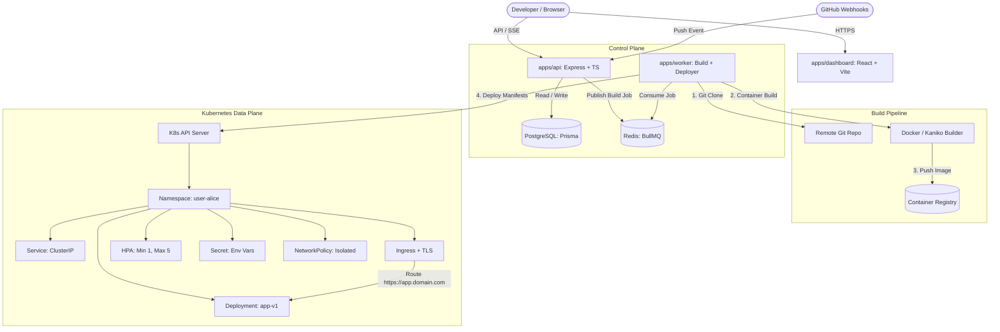

# DeployForge 🚀
> **Production-grade self-service developer deployment platform (Mini-Heroku / Vercel in a Monorepo)**

DeployForge is a complete, developer-centric PaaS that automatically compiles source code, packages container images, provisions isolated multi-tenant Kubernetes environments, configures TLS-terminated ingresses, and provides live logs, auto-scaling, and rollback capabilities.

---

## 🌟 Key Features

- **GitHub Integration**: Authenticate with GitHub OAuth and import repositories with branch selection.
- **Smart Image Builder**: Automatically detects `Dockerfile` or synthesizes an optimized container buildpack for Node.js, Python Flask, or Static HTML sites.
- **Real-Time Build Streaming**: Watch container build output in real time over Server-Sent Events (SSE) directly in the web dashboard.
- **Kubernetes Orchestration**: Provisions per-user namespaces, Deployments (non-root security context), ClusterIP Services, Ingresses, LimitRanges, ResourceQuotas, and default-deny NetworkPolicies.
- **Auto-Scaling (HPA)**: Dynamically scales replicas based on CPU target thresholds.
- **One-Click Instant Rollback**: Revert deployments instantly to any previous successful release with zero downtime.
- **Automated Webhook Deployments**: Push to your default branch on GitHub to trigger immediate zero-downtime rolling redeployments.
- **Full Observability**: Integrated runtime logs and real-time CPU/memory metrics visualization via Recharts.
- **Cost-Optimized Cloud Deployment**: Deploy to a single EC2 running K3s via Terraform for under $15/month, or scale to full AWS EKS.

---

## 🏗️ Architecture Overview



---

## 📂 Monorepo Structure

```
deployforge/
├── apps/
│   ├── dashboard/          # React + Vite + TypeScript + Tailwind UI
│   ├── api/                # Express API, Prisma ORM, BullMQ queue, Auth & SSE
│   └── worker/             # Build pipeline & K8s deployer worker
├── infra/
│   ├── terraform/          # AWS IaC (VPC, Security Groups, EC2 with K3s)
│   ├── helm/deployforge/   # Helm chart for deploying the platform itself
│   ├── argocd/             # GitOps Application manifests
│   └── monitoring/         # Prometheus, Loki, Grafana dashboard configs
├── sample-apps/            # Test applications
│   ├── node-express/       # Sample Node.js web app
│   ├── python-flask/       # Sample Python Flask app
│   └── static-html/        # Sample static HTML/Nginx app
├── .github/workflows/      # CI/CD pipelines (Trivy, TruffleHog, Helm deploy)
├── docs/                   # Architecture, Runbook, Interview Notes
├── docker-compose.yml      # Local development multi-container stack
├── Makefile                # Unified developer CLI tasks
└── README.md
```

---

## ⚡ Quick Start (Local Development)

### Prerequisites
- Node.js >= 20
- Docker & Docker Compose
- `kubectl` (optional, for K8s inspection)

### Run with Docker Compose
```bash
# Clone and enter directory
cd Mini-Heroku

# Start all platform components
make up

# Open Dashboard in your browser:
# http://localhost:3000
```

For configuration and production secrets, consult [docs/SETUP_NEEDED.md](file:///d:/Mini-Heroku/docs/SETUP_NEEDED.md).
