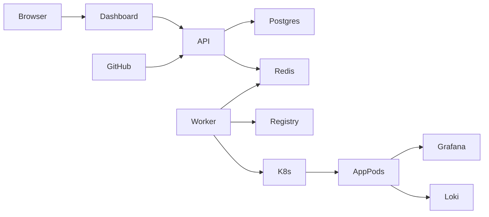

# DeployForge Architecture

DeployForge is a self-service deployment platform that resembles a mini-Heroku/Vercel for developers. It separates the control plane from the runtime plane so the platform can manage app builds, deployment lifecycle, observability, and isolated multi-tenant Kubernetes resources without coupling each project to a single shared namespace.

## Design goals

- Provide a developer-first workflow: GitHub login, repo selection, deployment trigger, live URL, logs, and rollback.
- Keep the platform reproducible locally with Docker Compose and remotely with a single EC2 + K3s cluster.
- Be production-minded: isolate workloads by namespace, default-deny network policies, secrets in Kubernetes, and least-privilege service accounts.
- Keep the codebase understandable for interviews: the API controls state, the worker executes the build/deploy pipeline, and the Kubernetes layer owns live runtime concerns.

## Runtime topology

## Control plane

The API is the front door for every user action. It exposes authentication, project CRUD, deployment lifecycle endpoints, GitHub webhook handling, and metrics endpoints. It uses Express, Prisma, JWT sessions, and Zod validation so requests are typed and guarded before they reach business logic.

Key responsibilities:
- Keep platform state in PostgreSQL.
- Publish build/deploy jobs to Redis BullMQ.
- Serve dashboard data and live metrics.
- Validate and sanitize user input and webhook payloads.
- Expose SSE/WebSocket-friendly events for build log streaming.

## Build and deployment pipeline

The worker is responsible for turning a GitHub repo into a running app. It is intentionally decoupled from the API so deployment work can run asynchronously and be retried independently.

The pipeline is:
1. Clone the target repository.
2. Detect whether a Dockerfile exists.
3. If no Dockerfile is present, synthesize a buildpack-based Dockerfile for Node.js, Python, or static HTML.
4. Build the image with a secure build mechanism such as buildkit or Kaniko-style semantics.
5. Push the image to the configured registry.
6. Create or update a namespace-scoped workload in Kubernetes.
7. Apply secret, service, ingress, and autoscaler resources.
8. Wait for readiness probes and surface a live URL.

This pattern makes the platform extensible without coupling the API to Docker internals or Kubernetes YAML details.

## Kubernetes isolation model

Each user app is deployed into its own namespace to prevent accidental cross-tenant interference.

Included controls:
- Resource quota for CPU, memory, Pods, and Services.
- Limit ranges for default CPU/memory values.
- Default-deny NetworkPolicy to restrict ingress.
- One Secret per app storing environment variables.
- HPA for CPU-based autoscaling.
- Ingress + TLS for public routing via a base domain.

This is the biggest production-quality architectural decision because it gives the platform multi-tenant behavior without requiring a full cluster-per-tenant model.

## Observability

DeployForge uses Prometheus for metrics and Loki for logs, with Grafana dashboards and Alertmanager rules. The dashboard reads the control-plane metrics and project telemetry to show CPU, memory, and runtime health. This keeps the platform observable without forcing a giant custom telemetry stack at MVP.

## Security model

Security is layered intentionally:
- GitHub OAuth and JWT sessions for user identity.
- No secrets committed in repo; environment files are generated via `.env.example` and runtime secrets in Kubernetes.
- Build isolation avoids privileged host execution.
- Pods run as non-root and drop capabilities.
- Trivy and secret scanning run in CI.
- OIDC-based GitHub Actions auth is preferred for cloud access.

## Why this architecture works

It balances modern platform engineering best practices with a manageable codebase. The control plane remains easy to reason about, the runtime plane remains isolated, and the platform can be bootstrapped locally with a single compose stack while still supporting a real EC2 + K3s cloud deployment path.
